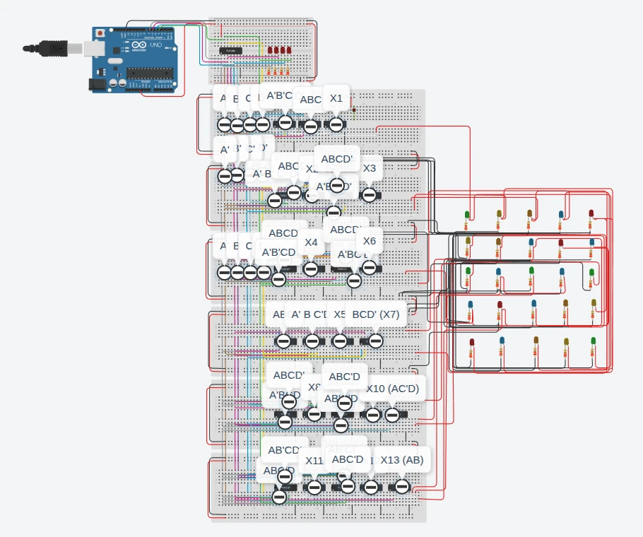

<div align="center">

# FINALS COMPORG: Festive Breadboard LED Logic Circuit

**An Arduino counts from 0 to 15 in binary, and 26 logic chips turn those four bits into 13 outputs that drive the LEDs. Built in Tinkercad Circuits.**


[](LICENSE)



<sub>The finished circuit in Tinkercad. The labels on the breadboards name the Boolean term each group of chips computes.</sub>

</div>

## What this shows
- A gate-level design: the Arduino only counts, and every output comes from the AND, OR and NOT chips.
- Four inputs (A, B, C, D) and 13 outputs (X1 to X13), with a full truth table and the product terms behind them, such as `AC'D`, `BCD'` and `AB`.
- A parts list and schematic that agree: every chip, LED and resistor in the bill of materials (85 electronic parts) appears in the six schematic sheets.

## Contents
- [What this shows](#what-this-shows)
- [About](#about)
- [How it works](#how-it-works)
- [Repository layout](#repository-layout)
- [Run it](#run-it)
- [Source documents](#source-documents)
- [License](#license)
- [Authors](#authors)

## About
The final project for Computer Architecture and Organization (COMPORG) at Asia Pacific College, built by a team of four BSIT students.

| | |
|---|---|
| Platform | Tinkercad Circuits (simulated Arduino Uno R3) |
| Inputs | 4 bits from the Arduino: D7 (A, most significant), D6 (B), D5 (C), D4 (D, least significant) |
| Logic chips | 1 hex inverter, 10 quad OR, 10 dual 4-input AND, 4 triple 3-input AND, 1 quad AND |
| Outputs | 13 logic outputs, X1 to X13 |
| LEDs | 29: 8 red, 8 blue, 5 green, 4 yellow, 4 orange, each behind a 220 Ω resistor |
| Breadboards | 1 small and 6 standard |

## How it works
1. **Count.** The sketch writes the numbers 0 to 15 to four pins, holding each for 300 ms, so one full cycle takes 4.8 seconds.
2. **Complement.** The hex inverter (U2) supplies `A'`, `B'`, `C'` and `D'`.
3. **Combine.** AND chips build the product terms and OR chips merge them into the outputs X1 to X13.
4. **Show.** The outputs drive the LEDs through 220 Ω resistors. The four red LEDs on the top breadboard are wired to the counter pins, so they show the current count in binary.

For counts 0 to 12, exactly one output goes high, in order. Counts 13, 14 and 15 light several outputs at once because the product terms overlap. The full table is in [docs/truth-table.md](docs/truth-table.md).

## Repository layout
```
firmware/finals_comporg_counter/finals_comporg_counter.ino   the counter sketch
docs/truth-table.md                                          truth table and Boolean terms
docs/schematic-transcription.md                              the six schematic sheets as text
docs/bill-of-materials.md                                    parts list with totals
docs/circuit.webp                                            picture of the finished circuit
LICENSE                                                      MIT
```

## Run it
There is no hardware to flash. To see it run:

1. Open the project in Tinkercad Circuits: [FINALS COMPORG](https://www.tinkercad.com/things/2AHTjSkFMHO-finals-comporg). The owner has to share it with you first.
2. Open **Code** and paste in `firmware/finals_comporg_counter/finals_comporg_counter.ino`.
3. Press **Start Simulation**. The count steps every 300 ms and the LEDs follow it.

To rebuild it from scratch, use the [bill of materials](docs/bill-of-materials.md) and the [schematic transcription](docs/schematic-transcription.md).

## Source documents
The schematic was exported from Tinkercad as a PDF and the parts list as a CSV. Both were transcribed into the Markdown files in `docs/`, and the originals are not stored here.

## License
Released under the [MIT License](LICENSE).

## Authors
- **Evan Prens P. Exanes** · [GitHub](https://github.com/evanexanes) · [Portfolio](https://evanexanes.github.io/) · [Contact](https://evanexanes.github.io/07-contact.html)
- **Jan Rain Alcantara**
- **Rhona-mae P. Prudenciado**
- **Bludylan Cyrus Pizarra**
